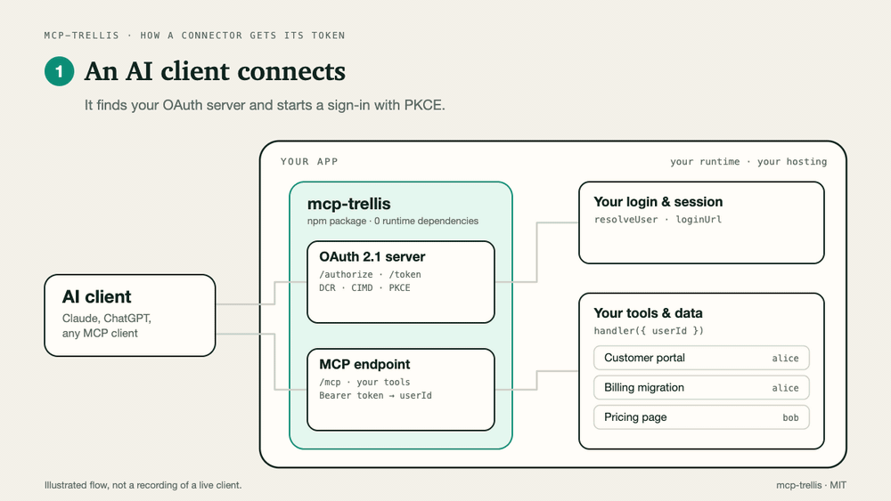
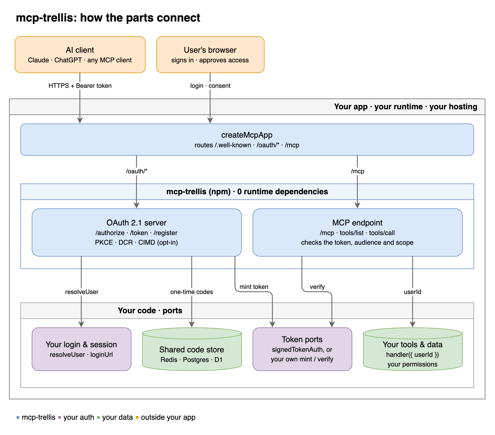

# mcp-trellis

Add user-scoped MCP to your existing TypeScript SaaS. Keep your login. Own your OAuth.

Claude and ChatGPT act as the signed-in user, not as a shared service account. The OAuth authorization server runs inside your app, reuses your existing session, and has zero runtime dependencies.

[](https://www.npmjs.com/package/mcp-trellis)
[](https://www.npmjs.com/package/mcp-trellis)
[](https://github.com/amir1824/mcp-trellis/actions/workflows/ci.yml)
[](LICENSE)




## The 30-second example

```ts
import { createMcpApp, signedTokenAuth } from "mcp-trellis";
import { session, projectsForUser, codeStore } from "./your-app.js";

export const mcp = createMcpApp<{ userId: string }>({
  serverInfo: { name: "my-saas", version: "1.0.0" },
  auth: signedTokenAuth({
    secret: process.env.MCP_SECRET!,
    resolveUser: (req) => session(req),
    loginUrl: (_r, n) => `/login?next=${encodeURIComponent(n)}`,
    codeStore,
  }),
  context: (_r, p) => ({ userId: p!.id }),
  tools: [{ name: "list_my_projects", description: "List projects",
    inputSchema: { type: "object", properties: {} }, scope: "mcp",
    handler: async ({ userId }) => JSON.stringify(await projectsForUser(userId)) }],
});
```

That is 15 lines of code. You bring two things: your own session lookup, and a shared store where one-time login codes can be used once (an atomic set-if-absent: Redis, Postgres, D1 or a Durable Object; Workers KV has no atomic NX). Node 20+.

Client ID Metadata Documents (CIMD) are supported and off by default: set `cimd: true`. Pass `cimdCache` too (strongly recommended: without it every refresh and revoke re-fetches the client document). Dynamic Client Registration works too.

Protocol: MCP 2024-11-05, 2025-03-26 and 2025-06-18 (default 2025-06-18). The 2026-07-28 revision, which deprecates Dynamic Client Registration in favor of CIMD, is planned and not supported yet. See the [roadmap](docs/ROADMAP.md).

## Quick start

1. `npm install mcp-trellis`
2. Wire `resolveUser` and `loginUrl` to your existing session.
3. Wire `codeStore` to a shared single-use store (Redis, Postgres, D1 or a Durable Object). trellis does not ship one; copy the adapter in [examples/stores.ts](examples/stores.ts), which is typechecked example code. `allowInMemoryCodeStore: true` is for single-process demos.
4. Deploy over HTTPS, then add your `/mcp` URL as a custom connector in Claude. The [client guide](docs/guide.md#clients) lists the client profiles.

`npm run demo` runs the local Alice and Bob demo: login, consent, then `list_my_projects`. See [examples/saas-demo](examples/saas-demo/README.md).

## How it fits together



The blue boxes ship in the package. The purple and green boxes are yours to plug in: your session, a code store, token handling and your data layer. `signedTokenAuth` gives you a default for the token ports. Editable source: [architecture.drawio](docs/media/architecture.drawio).

## When to use it, and when not

Use it when:

- Your TypeScript app already has login and user data, and Claude or ChatGPT should read and act on a signed-in user's own data (projects, tickets, invoices) with no shared service account.
- You want the MCP handler and the OAuth endpoints in one package, on Next.js, Express or Cloudflare Workers.
- Your tools should follow the permissions and tenant boundaries the app already enforces ([multi-tenant](docs/guide.md#multi-tenant-saas-connectors)).

Skip it when:

- You need a managed identity provider, a user database, or a login system built for you.
- You need MCP spec 2026-07-28 today, or a client combination that is not in the [compatibility table](docs/compatibility.md).
- You only need a local stdio tool, or you already run an MCP server and authorization server that meet your needs.

## Compared with the alternatives

| Option | Who hosts the authorization server | You need | Choose it when |
|---|---|---|---|
| **mcp-trellis** | Your app | Your session lookup and a shared single-use store | You want no new vendor, database or hosted service |
| [Better Auth MCP plugin](https://better-auth.com/docs/plugins/mcp) | Your app | Better Auth, its database schema and the JWT plugin | You already use Better Auth, or you need spec 2026-07-28 today (it targets that revision) |
| [Cloudflare workers-oauth-provider](https://github.com/cloudflare/workers-oauth-provider) | Your Worker | A Workers-only app and a KV namespace | You run only on Workers and want Cloudflare's own library |
| [Scalekit](https://docs.scalekit.com/authenticate/mcp/quickstart/) | Scalekit | A Scalekit dashboard and SDK | You want a hosted identity provider instead of running the authorization server |
| [WorkOS AuthKit (Standalone Connect)](https://workos.com/docs/authkit/mcp) | WorkOS | A Login URI set in WorkOS, and a call to AuthKit's completion API from your login | You want the authorization server hosted for you and still keep your own login |
| [Official TypeScript SDK v2](https://ts.sdk.modelcontextprotocol.io/v2/migration/upgrade-to-v2) | Nobody. v2 ships resource-server helpers only; the old authorization server helpers live in a frozen, deprecated `@modelcontextprotocol/server-legacy/auth`. | An authorization server from somewhere else | You already have one and only need to verify its tokens |

Checked 2026-11-07. These projects move fast, so re-verify before you decide.

## Integrate with your app

Choose your token mode:

- Start with `signedTokenAuth`: one secret. Access tokens are stateless, and the only stored state is single-use marks in `codeStore`. Access tokens cannot be revoked before they expire.
- Need revocable tokens, refresh-token families or your own JWT/JWKS? Implement the `mintAccessToken`, `verifyToken`, `refreshAccessToken` and `revokeToken` ports.
- Mint tokens for the requested MCP resource and return the verified `audience`. The library rejects a mismatch before a tool runs.
- A token outlives the login session that produced it. Pass `isUserActive` so a removed or disabled user stops working on the next request. Pass `refreshTtlSeconds` (needs `codeStore` and `isUserActive`) so a connector renews without sending the user back to the browser. What ends what: [Sessions and expiry](docs/security.md#sessions-and-expiry).

Before you ship:

- Your data layer must enforce ownership and tenancy. The library does not.
- Users see an OAuth consent screen even when already signed in to your app.
- Browser callers that send an `Origin` header need `allowedRequestOrigins`. It is fail-closed by default.
- CIMD fetches client metadata over HTTPS, for public clients only. The connection is not pinned to the looked-up IP, so DNS rebinding is possible. Do not rely on it as your only SSRF defense ([security.md](docs/security.md)).

## Clients and compatibility

| Profile | Implemented server flow | Live client evidence |
|---|---|---|
| Claude (`claude`) | Dynamic registration, public client, PKCE; CIMD with `cimd: true` | Used in the maintainer's own production servers (reported); logged live pass pending |
| ChatGPT / Codex (`codex`) | Public client, PKCE; ChatGPT's stable and per-connector callbacks allowed | Pending for each product |
| Gemini Enterprise (`gemini`) | Pre-registered client; secret basic/post; requires `clientStore` | Pending; does not imply every Gemini product |

The OAuth flows above run in automated tests and in the local demo. [docs/compatibility.md](docs/compatibility.md) has the checklist for testing each vendor app, plus [client configuration](docs/guide.md#clients) and [troubleshooting](docs/troubleshooting.md).

## Docs

| Doc | Contents |
|-----|----------|
| [docs/guide.md](docs/guide.md) | Architecture, clients, recipes, ports, tools, multi-tenant |
| [docs/reference.md](docs/reference.md) | Routes, methods, status codes, options, exports |
| [docs/security.md](docs/security.md) | Protocol promises, threat model, sessions, not in scope |
| [docs/compatibility.md](docs/compatibility.md) | Protocol versions, client profiles, test evidence |
| [docs/troubleshooting.md](docs/troubleshooting.md) | Common connection and token errors |
| [docs/ROADMAP.md](docs/ROADMAP.md) | What's next |

Examples: [saas-demo](examples/saas-demo/README.md), [nextjs-saas](examples/nextjs-saas/README.md), and [project-desk](examples/project-desk/README.md), a reference remote server example. More recipes in [`examples/`](examples/).

## Contributing

Found a bug or a gap? Open an [issue](https://github.com/amir1824/mcp-trellis/issues). Pull requests are welcome, see [CONTRIBUTING.md](CONTRIBUTING.md).

```bash
npm test
npm run build
npm run typecheck
```

## License

MIT
