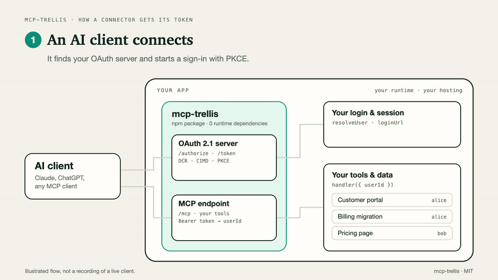
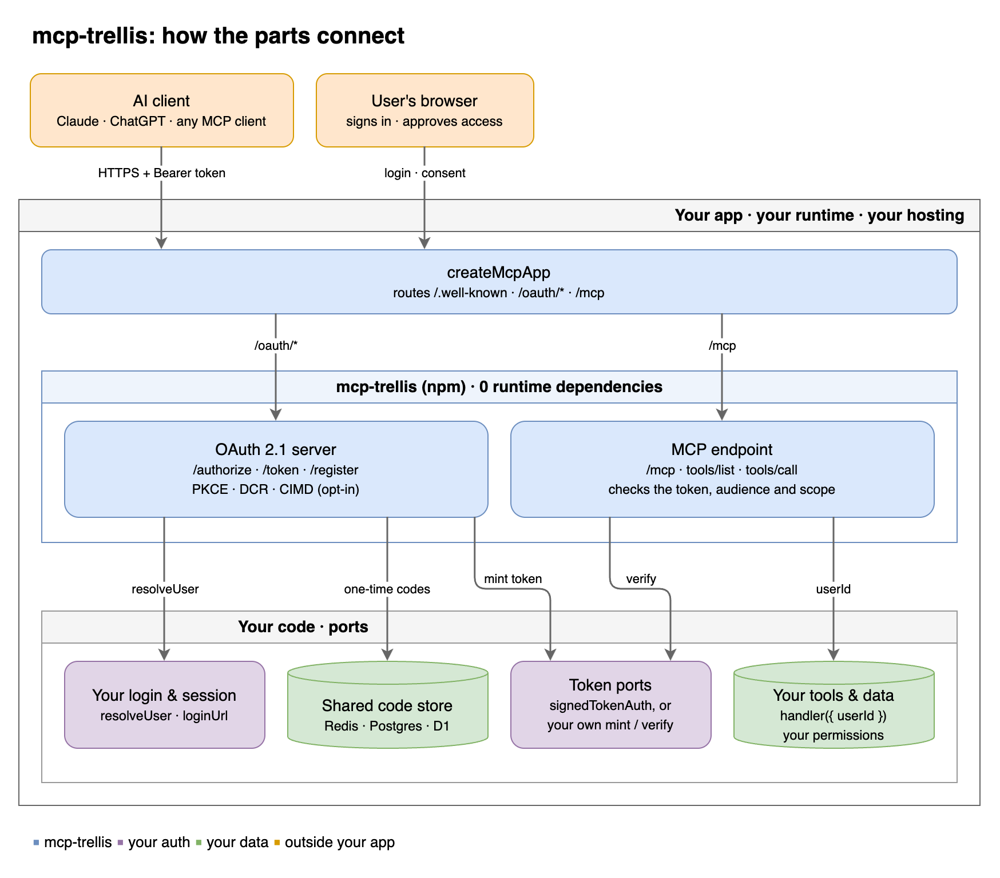

# mcp-trellis

Add user-scoped MCP to your existing TypeScript SaaS. Keep your login. Own your OAuth.

Claude and ChatGPT act as the signed-in user, not as a shared service account. The OAuth authorization server runs inside your app, reuses your session, and has zero runtime dependencies. Node 20+.

[](https://www.npmjs.com/package/mcp-trellis)
[](https://www.npmjs.com/package/mcp-trellis)
[](https://github.com/amir1824/mcp-trellis/actions/workflows/ci.yml)
[](LICENSE)




## The 30-second example

```ts
import { createMcpApp, signedTokenAuth } from "mcp-trellis";
import { session, projectsForUser, codeStore } from "./your-app.js";

export const mcp = createMcpApp<{ userId: string }>({
  serverInfo: { name: "my-saas", version: "1.0.0" }, clients: ["claude", "codex"],
  auth: signedTokenAuth({
    secret: process.env.MCP_SECRET!,
    resolveUser: (req) => session(req),
    loginUrl: (_r, n) => `/login?next=${encodeURIComponent(n)}`,
    codeStore,
  }),
  context: (_r, p) => ({ userId: p?.id ?? "" }),
  tools: [{ name: "list_my_projects", description: "List projects",
    inputSchema: { type: "object", properties: {} }, scope: "mcp",
    handler: async ({ userId }) => JSON.stringify(await projectsForUser(userId)) }],
});
```

That is the configuration, not the whole server. Mount the returned app (it has a `fetch(Request)` method) on your HTTP framework: [Express](examples/express.ts), [Next.js](examples/nextjs-saas) or a [Cloudflare Worker](examples/cloudflare-worker.ts). It serves `/mcp`, the OAuth routes and `.well-known` discovery.

You bring two things: your session lookup, and a shared store where a one-time login code can be used once (an atomic set-if-absent: Redis, Postgres, D1 or a Durable Object; Workers KV has no atomic NX).

- `clients` picks presets for the connector clients you serve (default `["claude"]`): their callback URIs and token-endpoint auth methods. It is not an allowlist: dynamic registration accepts any client whose redirect URI passes the policy, and loopback redirects are allowed by default. See [Locking down who can register](docs/guide.md#locking-down-who-can-register).
- OAuth tells your server who is calling. It does not say which tenant or record that user may touch: check that in your data layer on every operation.
- Client ID Metadata Documents (CIMD) are off by default: set `cimd: true` and pass `cimdCache`, or every refresh and revoke fetches the client document again. Dynamic Client Registration works too.

**Protocol versions.** MCP 2024-11-05, 2025-03-26 and 2025-06-18 (default 2025-06-18) are negotiated in `initialize`. MCP 2026-07-28 is served per request when the client sends `MCP-Protocol-Version: 2026-07-28` with the `_meta` and `Mcp-Method` fields that revision requires. An unknown `MCP-Protocol-Version` header gets a 400. Details: [reference](docs/reference.md#2026-07-28-requests).

## Quick start

1. `npm install mcp-trellis`
2. Wire `resolveUser` and `loginUrl` to your existing session.
3. Wire `codeStore` to a shared single-use store (Redis, Postgres, D1 or a Durable Object). mcp-trellis does not ship one; copy the adapter in [examples/stores.ts](examples/stores.ts). `allowInMemoryCodeStore: true` is for single-process demos only.
4. Deploy over HTTPS, then add your `/mcp` URL as a custom connector in Claude. The [client guide](docs/guide.md#clients) lists the client profiles.

To run the local Alice and Bob demo (login, consent, then `list_my_projects`), set two variables first. It stops with an error without them.

```bash
export DEMO_PASSWORD="$(openssl rand -hex 16)"
export OAUTH_CODE_SECRET="$(openssl rand -hex 32)"
npm run demo
```

Open `http://127.0.0.1:8787` and sign in as Alice or Bob with `$DEMO_PASSWORD`. More in [examples/saas-demo](examples/saas-demo/README.md).

## Tool UIs, resources and skills

- **MCP Apps.** A tool can point at an HTML view that a host with [MCP Apps](https://github.com/modelcontextprotocol/ext-apps) renders next to the result. The view calls back through your `/mcp` endpoint, so scopes, validation, `context` and `audit` still apply. Documents are `html` or `blob`, with CSP, permissions, `domain` and `prefersBorder`. For 2026-07-28 requests the server sends the UI only to a client that declared the Apps extension.
- **Typed results.** A tool can declare an `outputSchema` (checked against each result) and `annotations`; `structuredContent` may be any JSON value for 2026-07-28 clients. Schemas are evaluated natively as JSON Schema 2020-12; `x-mcp-header` mirrors an argument into a request header. See [docs/reference.md](docs/reference.md#tool-results-and-annotations).
- **Resources.** `resources` serves read-only text to the principals allowed to see it. See [docs/resources.md](docs/resources.md).
- **Skills (experimental).** `skills` serves Agent Skills over MCP, opt-in. See [docs/skills.md](docs/skills.md).

```ts
import { createMcpApp, defineTool } from "mcp-trellis";

const listProducts = defineTool({
  name: "list_products",
  description: "Show the signed-in user's products",
  inputSchema: { type: "object", properties: {} },
  scope: "mcp",
  ui: { resourceUri: "ui://shop/products" }, // must match a uiResources entry
  handler: async (ctx) => ({
    content: [{ type: "text", text: "2 products" }], // fallback for hosts without MCP Apps
    structuredContent: { items: await loadProducts(ctx) }, // what the view receives
  }),
});

export const mcp = createMcpApp({
  // ...serverInfo, auth, context as above
  tools: [listProducts],
  uiResources: [{ uri: "ui://shop/products", html: productsHtml }],
});
```

No MCP Apps host and no 2026-07-28 client is verified by this project's tests. Setup, CSP and limits: [docs/mcp-apps.md](docs/mcp-apps.md).

## How it fits together



The blue boxes ship in the package. The purple and green boxes are yours to plug in: your session, a code store, token handling and your data layer. `signedTokenAuth` gives you a default for the token ports. Editable source: [architecture.drawio](docs/media/architecture.drawio).

## When to use it, and when not

Use it when:

- Your TypeScript app already has login and user data, and Claude or ChatGPT should read and act on a signed-in user's own data (projects, tickets, invoices) with no shared service account.
- You want the MCP handler and the OAuth endpoints in one package, on Next.js, Express or Cloudflare Workers.
- Your tools should follow the permissions and tenant boundaries the app already enforces ([multi-tenant](docs/guide.md#multi-tenant-saas-connectors)).

Skip it when:

- You need a managed identity provider, a user database, or a login system built for you.
- You need a client that is not in the client table below.
- You only need a local stdio tool, or you already run an MCP server and authorization server that meet your needs.

## Compared with the alternatives

| Option | Who hosts the authorization server | You need | Choose it when |
|---|---|---|---|
| **mcp-trellis** | Your app | Your session lookup and a shared single-use store | You want no new vendor, database or hosted service |
| [Better Auth MCP plugin](https://better-auth.com/docs/plugins/mcp) | Your app | Better Auth, its database schema and the JWT plugin | You already use Better Auth |
| [Cloudflare workers-oauth-provider](https://github.com/cloudflare/workers-oauth-provider) | Your Worker | A Workers-only app and a KV namespace | You run only on Workers and want Cloudflare's own library |
| [Scalekit](https://docs.scalekit.com/authenticate/mcp/quickstart/) | Scalekit | A Scalekit dashboard and SDK | You want a hosted identity provider instead of running the authorization server |
| [WorkOS AuthKit (Standalone Connect)](https://workos.com/docs/authkit/mcp) | WorkOS | A Login URI set in WorkOS, and a call to AuthKit's completion API from your login | You want the authorization server hosted for you and still keep your own login |
| [Official TypeScript SDK v2](https://ts.sdk.modelcontextprotocol.io/v2/migration/upgrade-to-v2) | Nobody. v2 ships resource-server helpers only; the old authorization server helpers live in a frozen, deprecated `@modelcontextprotocol/server-legacy/auth`. | An authorization server from somewhere else | You already have one and only need to verify its tokens |

Checked 2026-11-07. Re-verify before you decide.

## Integrate with your app

Choose your token mode:

- Start with `signedTokenAuth`: one secret. Access tokens are stateless; the only stored state is single-use marks in `codeStore`. A token cannot be revoked before it expires; pass `isUserActive` to cut off a user at once.
- Need revocable tokens, refresh-token families or your own JWT/JWKS? Implement the `mintAccessToken`, `verifyToken`, `refreshAccessToken` and `revokeToken` ports.
- Mint tokens for the requested MCP resource and return the verified `audience`. The library rejects a mismatch before a tool runs.
- A token outlives the login session that produced it. `isUserActive` stops a removed or disabled user on the next request. `refreshTtlSeconds` (needs `codeStore` and `isUserActive`) lets a connector renew without a browser trip. See [Sessions and expiry](docs/security.md#sessions-and-expiry) and the [production auth profile](docs/security.md#production-auth-profile).

Before you ship:

- Your data layer must enforce ownership and tenancy. The library does not.
- Users always see an OAuth consent screen, even when signed in to your app.
- A request with an `Origin` header is rejected unless it matches `allowedRequestOrigins`. Native connectors send none.
- CIMD fetches client metadata over HTTPS, for public clients only. By default the connection is not pinned to the looked-up IP, so DNS rebinding is possible; see `cimdFetch` in the [reference](docs/reference.md) and [security.md](docs/security.md).
- There is no built-in rate limiting. Put quotas on `/register` and `/token` at your edge or reverse proxy, and on `/authorize` too when `cimd: true`.
- No third-party security audit has been done. The threat model is in [security.md](docs/security.md).

## Clients and compatibility

| Profile | Implemented server flow | Live client evidence |
|---|---|---|
| Claude (`claude`) | Dynamic registration, public client, PKCE; CIMD with `cimd: true` | Verified manually by the maintainer (connects and works), 2026-11; no recorded transcript |
| ChatGPT / Codex (`codex`) | Public client, PKCE; ChatGPT's stable and per-connector callbacks allowed | ChatGPT connector verified manually by the maintainer (connects and works), 2026-11; no recorded transcript. Codex CLI not tested |
| Gemini Enterprise (`gemini`) | Pre-registered client; secret basic/post; requires `clientStore` | Pending; does not imply every Gemini product |

The OAuth flows above run in automated tests and in the local demo. The Claude and ChatGPT results are manual checks, not CI runs. See [client configuration](docs/guide.md#clients) and [troubleshooting](docs/troubleshooting.md).

## Docs

| Doc | Contents |
|-----|----------|
| [docs/guide.md](docs/guide.md) | Clients, ports, consent, tools, multi-tenant |
| [docs/mcp-apps.md](docs/mcp-apps.md) | Attach a UI to a tool: setup, document fields, CSP, negotiation, limits |
| [docs/resources.md](docs/resources.md) | Serve read-only data as resources |
| [docs/skills.md](docs/skills.md) | Experimental: Agent Skills over MCP |
| [docs/reference.md](docs/reference.md) | Routes, methods, status codes, options, exports |
| [docs/security.md](docs/security.md) | Protocol promises, threat model, sessions, not in scope |
| [docs/troubleshooting.md](docs/troubleshooting.md) | Connection, token, schema and header errors |

Examples: [project-desk](examples/project-desk/README.md) (reference remote server), [saas-demo](examples/saas-demo/README.md), [nextjs-saas](examples/nextjs-saas/README.md). All in [`examples/`](examples/README.md).

## Contributing

Open an [issue](https://github.com/amir1824/mcp-trellis/issues) for a bug or gap. Pull requests are welcome: see [CONTRIBUTING.md](CONTRIBUTING.md) and the [Code of Conduct](CODE_OF_CONDUCT.md).

## License

MIT
