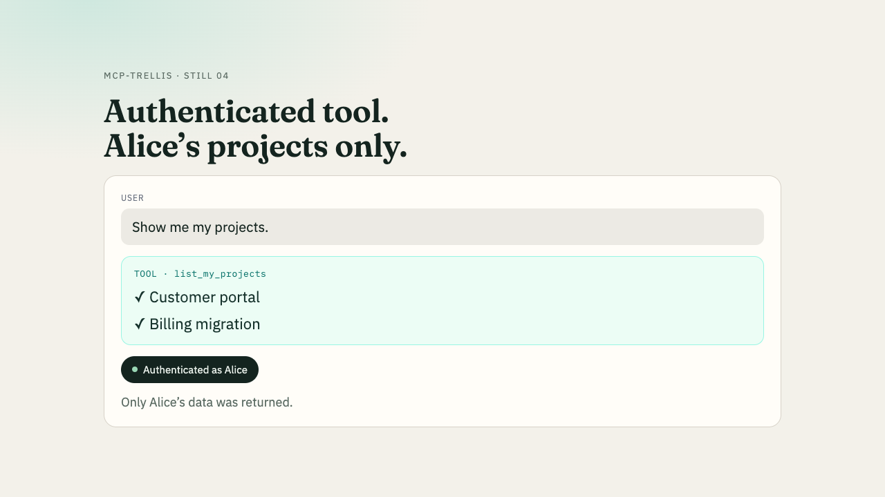
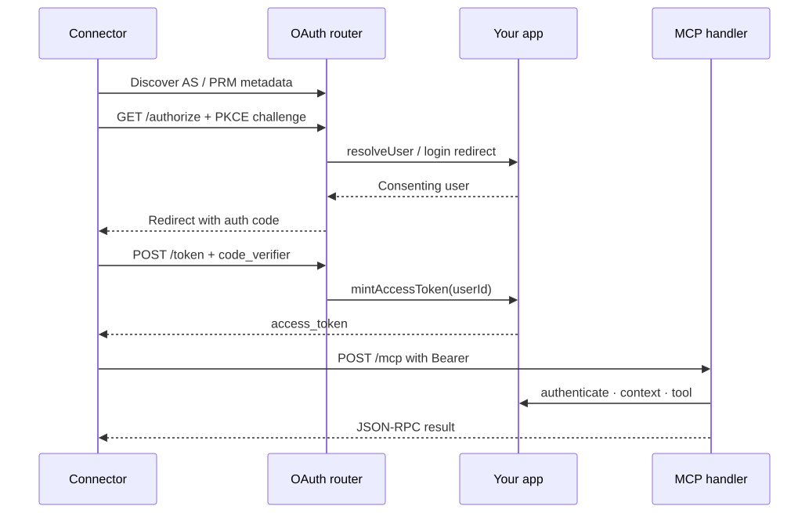

# mcp-trellis

Plug your existing SaaS's users, login and permissions into MCP with OAuth 2.1 —
so Claude, ChatGPT and other AI clients can act on your app **as that user**,
with one npm install and no separate identity provider.

```
Existing SaaS
users + login + data
       ↓
    mcp-trellis
       ↓
Claude / ChatGPT / Gemini
```

[](https://www.npmjs.com/package/mcp-trellis)
[](https://github.com/amir1824/mcp-trellis/actions/workflows/ci.yml)
[](LICENSE)

## Demo



<!-- TODO: replace the screenshot above with a ~20s GIF of the full flow
     (app login → OAuth consent → a Claude/ChatGPT tool call returning
     user-scoped data). Do not add a placeholder image file until a real
     recording exists — see docs/compatibility.md for the live-client
     evidence this still needs. -->

```bash
npm install mcp-trellis
```

## The 30-second example

```ts
import { createMcpApp, signedTokenAuth } from "mcp-trellis";
import { session, projectsForUser, codeStore } from "./your-app.js";

export const mcp = createMcpApp<{ userId: string }>({
  serverInfo: { name: "my-saas", version: "1.0.0" },
  auth: signedTokenAuth({
    secret: process.env.MCP_SECRET!,
    resolveUser: (req) => session(req),
    loginUrl: (_r, n) => `/login?next=${encodeURIComponent(n)}`,
    codeStore,
  }),
  context: (_r, p) => ({ userId: p!.id }),
  tools: [{ name: "list_my_projects", description: "List projects",
    inputSchema: { type: "object", properties: {} }, scope: "mcp",
    handler: async ({ userId }) => JSON.stringify(await projectsForUser(userId)) }],
});
```

`codeStore` must be a shared single-use store (Redis/KV — see [examples/stores.ts](examples/stores.ts)). Advanced ports (`mintAccessToken`, `verifyToken`, refresh, revoke) remain available when you outgrow the helper. Node ≥20.

**[View the complete SaaS demo](examples/saas-demo/README.md)** — working login, consent, two users with different projects.

Also listed on the Official MCP Registry as **Project desk** (reference remote server; not the SDK) — see [`examples/project-desk`](examples/project-desk/).

## Use cases

- Let Claude or ChatGPT read and act on a signed-in user's **own** data (their projects, tickets, invoices) in your product — no shared service account, no "god token".
- Add a remote MCP connector to a Next.js, Express, or Cloudflare Workers app that already has sessions and a user table, without introducing a separate identity provider.
- Give an AI agent tools that are scoped by the same permissions and multi-tenant boundaries your app already enforces (see [Multi-tenant](docs/guide.md#multi-tenant-saas-connectors)).
- Expose a handful of user-scoped tools from an existing codebase in under 15 lines, instead of standing up an MCP server and an OAuth stack as two separate projects.

## When should I use this?

- Your TypeScript app already has login and user data, and you want to expose user-scoped tools through remote MCP.
- You want the MCP handler and OAuth authorization endpoints in one package, with zero runtime dependencies.
- You want to reuse your runtime and existing storage. The library does not require a new database; production deployments still need appropriate replay, token and session storage.

## When should I not use this?

- You need a managed identity provider, a user database, or a login system built for you.
- You already have an MCP server and authorization server that meet your needs.
- You need protocol features or client combinations absent from the [verified support table](docs/compatibility.md).
- You only need a local stdio tool with no remote authorization flow.

## Why trellis vs the official SDK / fastmcp / mcp-framework

The [official TypeScript SDK](https://github.com/modelcontextprotocol/typescript-sdk),
[fastmcp](https://github.com/punkpeye/fastmcp) and
[mcp-framework](https://github.com/QuantGeekDev/mcp-framework) are general-purpose
tools for building a **new** MCP server. mcp-trellis is narrower on purpose: it
wires an **existing** SaaS's users and login into MCP as a self-hosted OAuth 2.1
authorization server. Checked against each project's README and `package.json`
on 2026-10-29 — re-verify before relying on it, all four move fast:

| | Official SDK (`@modelcontextprotocol/server`) | fastmcp | mcp-framework | **mcp-trellis** |
|---|---|---|---|---|
| Primary job | Reference MCP protocol implementation (server + client) | General-purpose framework for a new MCP server (tools, resources, prompts, OpenAPI import, sampling, …) | General-purpose framework + CLI scaffolding for a new MCP server | Adds user-scoped tools and an OAuth login to an **existing** app — not a general server builder |
| Self-hosted OAuth 2.1 AS (its own `/authorize` + `/token`) | No — ships auth *helpers*; you build the AS | Partial — built-in **OAuth Proxy** in front of an upstream IdP (Google/GitHub/Azure, or any RFC-compliant OAuth 2.0 server you already run) | No — `OAuthAuthProvider` only *verifies* tokens (JWT/JWKS or introspection) from an AS you already run elsewhere | **Yes** — `createOAuthRouter` / `createMcpApp` implement authorize + token themselves |
| Turns your app's existing session/login into that AS, no separate IdP | No | No — proxies to an external IdP | No — requires an external AS | **Yes** — via `resolveUser` + `loginUrl` (see [`signedTokenAuth`](#the-30-second-example)) |
| Resources, prompts, sampling, CLI project scaffolding | Yes | Yes | Yes | No — out of scope, see [docs/ROADMAP.md](docs/ROADMAP.md#non-goals) |
| Runtime dependencies | 2 (`zod` + an internal core package) | ~13 (`hono`, `zod`, `@modelcontextprotocol/sdk`, …) | ~9 (`jsonwebtoken`, `jwks-rsa`, …) | **0** |

If you're building a brand-new MCP server, any of the three above is a better
fit — they have the ecosystem, docs, and tooling for exactly that. mcp-trellis
solves a narrower problem: you already have a SaaS with users and permissions,
and you want Claude/ChatGPT to act on it **as a specific signed-in user**
without standing up a separate identity provider. For a feature matrix against
identity-product compositions (xmcp + Scalekit, WorkOS, Descope, Auth0, …), see
[docs/ROADMAP.md](docs/ROADMAP.md).

## Run a real tool

The [Project desk demo](examples/saas-demo/README.md) is the canonical example ([`examples/project-desk`](examples/project-desk/) implementation): app login → OAuth consent → access token → `list_my_projects`. Alice sees her two projects; Bob sees his own. It uses fictional data and an independent app session.

**Live Claude / ChatGPT recordings are still pending.** Automated OAuth tests are not evidence that a current vendor client has connected successfully.

## Clients and compatibility

| Profile | Implemented server flow | Live client evidence |
|---|---|---|
| Claude (`claude`) | Dynamic registration, public client, PKCE | Pending |
| ChatGPT / Codex (`codex`) | Public client, PKCE; configure exact hosted callback as needed | Pending for each product |
| Gemini Enterprise (`gemini`) | Pre-registered client; secret basic/post; requires `clientStore` | Pending; does not imply every Gemini product |

Protocol versions implemented: `2024-11-05`, `2025-03-26`, `2025-06-18`; default `2025-06-18`. See [test evidence and verification checklist](docs/compatibility.md), [client configuration](docs/guide.md#clients) and [troubleshooting](docs/troubleshooting.md).

## Integrate with your app

Prefer `signedTokenAuth` for a one-secret start. For refresh, revoke, or your own JWT/JWKS, implement `resolveUser`, `loginUrl`, `mintAccessToken` and `verifyToken` yourself. Mint tokens for the requested MCP resource and return their verified `audience`; the library rejects an audience mismatch before executing tools. A logged-in user still sees an OAuth consent screen. Your data layer must enforce ownership and tenant permissions. Browser callers that send an `Origin` header need `allowedRequestOrigins` (fail-closed by default) — see [security.md](docs/security.md).

[SaaS demo](examples/saas-demo/README.md) · [Next.js starter](examples/nextjs-saas/README.md) · [Host recipes](docs/guide.md) · [Security](docs/security.md) · [npm](https://www.npmjs.com/package/mcp-trellis)

## How it compares

mcp-trellis is the **vendor-neutral embedded BYO-auth** path: MCP handler and self-hosted OAuth AS in one npm install. Contrast composition stacks such as **xmcp + Scalekit** (or WorkOS / Descope connectors) that split the MCP runtime and the identity product across 2–3 packages. Full comparison table: [docs/ROADMAP.md](docs/ROADMAP.md).

## Architecture

`createMcpApp` wires MCP and OAuth and routes between them:





Host recipes, ports, tools, and multi-tenant: [docs/guide.md](docs/guide.md).

## Docs

| Doc | Contents |
|-----|----------|
| [docs/guide.md](docs/guide.md) | Architecture, clients, recipes, ports, tools, multi-tenant |
| [docs/reference.md](docs/reference.md) | Routes, methods, status codes, options, exports |
| [docs/security.md](docs/security.md) | Protocol promises, threat model, not in scope |
| [docs/ROADMAP.md](docs/ROADMAP.md) | What's next |

Canonical example: [`examples/project-desk`](examples/project-desk/) ([local docs](examples/saas-demo/)). Recipes: [`examples/`](examples/).

## Contributing

PRs welcome — see [CONTRIBUTING.md](CONTRIBUTING.md).

```bash
npm test
npm run build
npm run typecheck
```

## License

MIT
